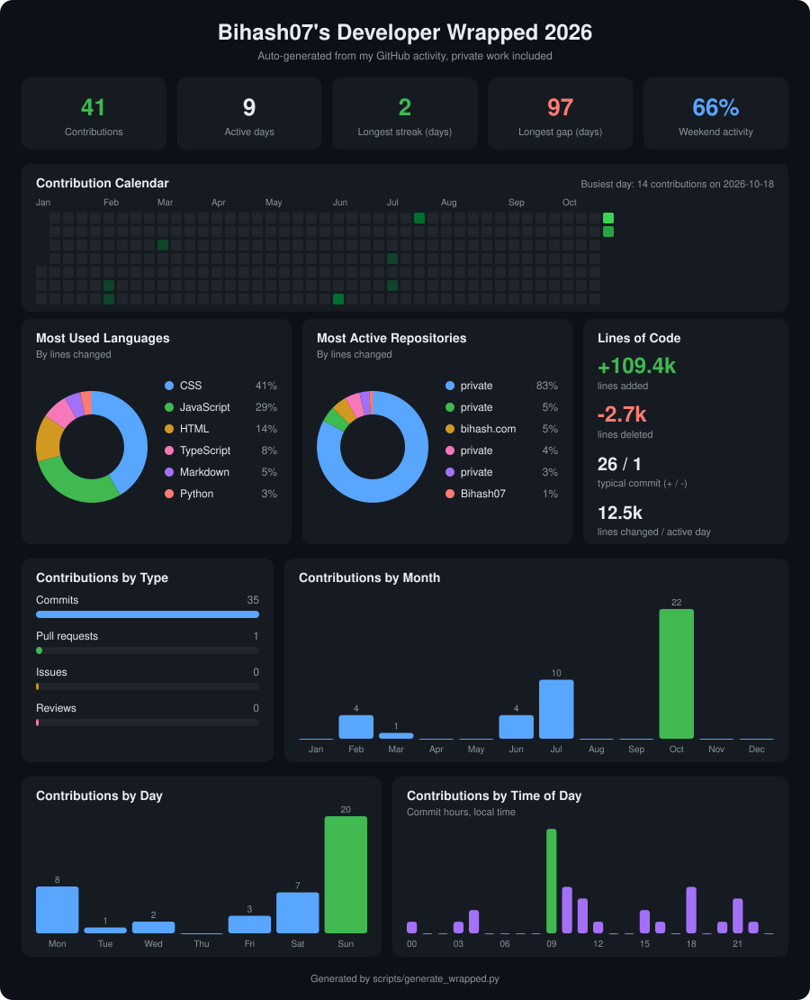

# Bihash Arulampalam

### AI-Powered Apps · Full-Stack Development · Test Automation

 

---

## About

I build software that works reliably and uses AI where it actually helps. From intelligent assistants and automation workflows to full-stack web apps and well-tested APIs, I take solutions from idea to a working, end-to-end product.

I'm currently available for **freelance projects, contracts and full-time roles**.

## What I Build

| | |
|---|---|
| **AI-Powered Applications** | Turning modern AI models and APIs into useful applications, intelligent assistants and automation workflows. |
| **Full-Stack Software Development** | Building responsive web applications, REST APIs, backend services and database-driven systems. |
| **Test Automation & Software Quality** | Developing automated test suites, testing APIs and making sure applications work reliably across different scenarios. |
| **Intelligent Systems & Integration** | Connecting AI services, external APIs, databases and software components into practical, end-to-end solutions. |

## ⚡ Tech Stack

### AI & Machine Learning

-
### Python & Backend Development

-
### Frontend Development

-
### Backend & Databases

-
### Testing & Automation

-
### Developer Tools & Version Control

-

## Featured Projects

**[Language Passport](https://github.com/your-username/language-passport) :**
Personalised AI language tutor built with React and modern AI APIs.

**[Cutestuff.lk](https://your-link) :**
E-commerce and creative brand I founded, covering the storefront, operations and tooling end to end.

> More work in the pinned repositories below 👇

## Developer Analytics

Auto-updated daily from my GitHub activity, private work included.

## 🤝 Let's Work Together

Have an AI idea, an app to build, or software that needs solid testing?

📧 **[bihash.info@gmail.com](mailto:bihash.info@gmail.com)** · 🌐 **[portfolio](https://bihash.netlify.app/)**

*Build it smart. Test it well. Ship it reliably.*

